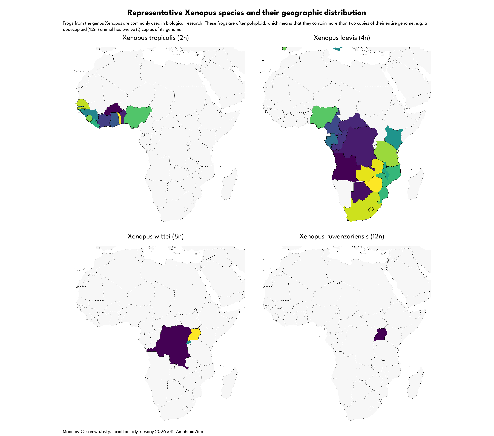

# Tidy Tuesday 2026 #41: Frogs and Toads

Because I am a frog scientist this one was exciting for me!

### The graph

### Things I learned:

1. How to use the `patchwork` package to slap graphs together.
2. Writing functions that output graphs.
3. Handling map data, only not really, because I used the `quick_map()` function from the `countries` package.
4. How to handle large amounts of text on a graph.

